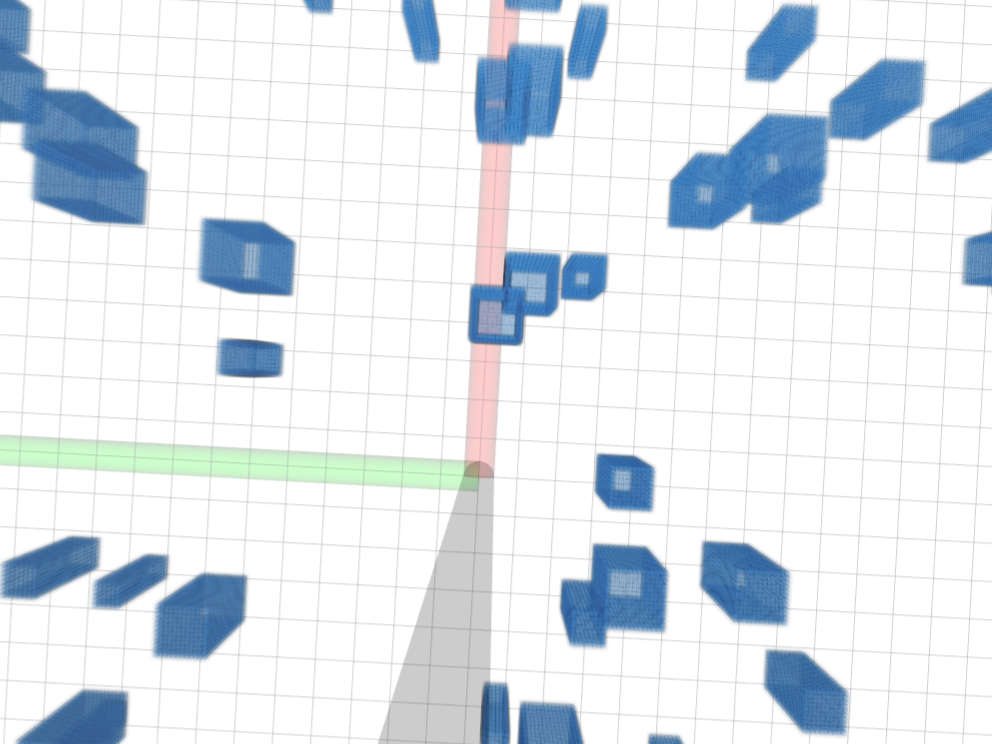

<div align="center">

**🌐 [English](README.md) | 简体中文**

</div>

# 1. 项目概述
本项目整合了 ZJU-FAST-Lab 的三个已有项目：ego-planner、Elastic-Tracker、Fast-Perching。只需运行一个 bash 脚本，即可在一个统一的仿真环境中运行其中任意一个项目。

# 2. 标准编译
**测试系统**：Ubuntu 20.04 + ros-noetic

**[注意！]** 记得修改 ego-planner 与 Elastic-Tracker 两个功能包中 `src/uav_simulator/local_sensing/CMakeLists.txt` 的 CUDA 选项。

> 从 GitHub 克隆代码
```
git clone https://github.com/wuuwuu26/Integrated-Simulation.git
```
> 逐个编译各功能包
```
cd ego-planner
catkin_make
```
```
cd Elastic-Tracker
catkin_make
```
```
cd Fast-Perching
catkin_make
```
> 赋予 bash 脚本执行权限
```
chmod +x mix.sh
chmod +x task_pub.sh
chmod +x start_ego.sh
chmod +x start_track.sh
chmod +x start_track_car.sh
chmod +x start_perch.sh
chmod +x stop_ego.sh
chmod +x stop_track.sh
chmod +x stop_perch.sh
```
> 运行地图并等待 `/task_id`
```
./mix.sh
```

> 运行任务发布器
```
./task_pub.sh
```

# 3. 关于地图
如需更换地图，请修改 `/ego-planner/src/planner/plan_manage/launch/map_generator.launch`。可调整 `mockamap_node` 的参数以生成不同的仿真环境。
```
<param name="seed" type="int" value="510"/>
<param name="update_freq" type="double" value="1.0"/>

<!-- 立方体边长，单位：米 -->
<param name="resolution" type="double" value="0.1"/>

<!-- 地图尺寸，单位：米 -->
<param name="x_length" value="$(arg map_size_x_)"/>
<param name="y_length" value="$(arg map_size_y_)"/>
<param name="z_length" value="$(arg map_size_z_)"/>

<!-- 地图生成类型：2 = perlin 随机盒地图 -->
<param name="type" type="int" value="2"/>

<!-- 地面参数：1 = 启用地面，0 = 禁用地面 -->
<param name="ground" type="int" value="0"/>

<!-- perlin 随机盒地图参数 -->
<param name="width_min" type="double" value="0.5"/>
<param name="width_max" type="double" value="1.5"/>
<param name="height_min" type="double" value="3.5"/>
<param name="height_max" type="double" value="4.5"/>
<param name="obstacle_number" type="int" value="120"/>
```

# 4. 已知问题
关于 task 5：由于 Fast-Perching 项目中没有避障程序，本项目的 task 5 无法避开地图中的障碍物。
